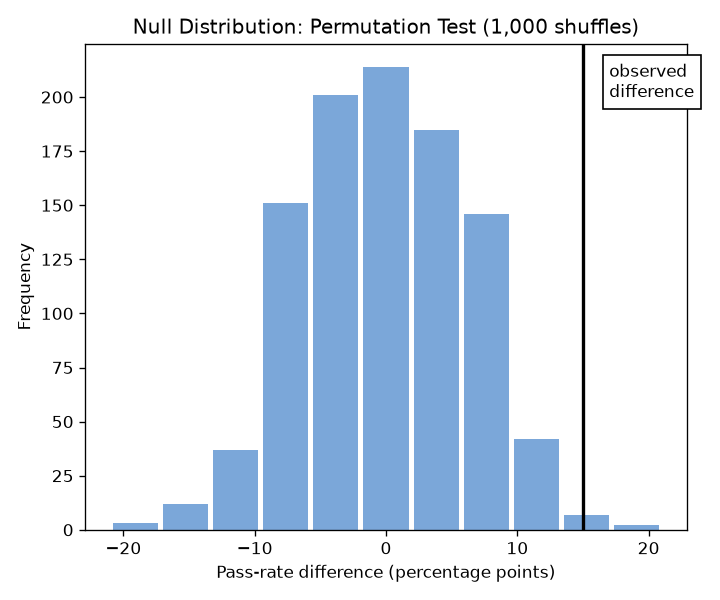

# Retail Sales: Statistical Inference and OLS Regression

> **Academic project** from a university course. Three notebooks that go from "what is related to sales?" to "by how much, and what should a store expect to sell?".

| Notebook | Question | Methods | Outputs in repo |
| --- | --- | --- | --- |
| [01_eda_hypothesis_testing](notebooks/01_eda_hypothesis_testing.ipynb) | Which factors are associated with store sales? | Median/mode imputation, 3x IQR outlier check, correlation heatmap, chi-square tests, one-way ANOVA | No (course dataset not included) |
| [02_permutation_test](notebooks/02_permutation_test.ipynb) | Did a new teaching method really raise pass rates? | Permutation test with 1,000 shuffles | **Yes, fully executed** |
| [03_ols_regression](notebooks/03_ols_regression.ipynb) | How much do shelf location, price, and advertising move sales? | Simple regression, forward stepwise selection on adjusted R-squared, dummy encoding, point forecast | No (course dataset not included) |

## Data

- Notebooks 01 and 03: a 400-store retail dataset provided for the course (`2nd_assignment.csv`, a version of the ISLR Carseats data). It is **not included**; see [`data/README.md`](data/README.md). These notebooks are published without outputs, and the numbers below for them come from the original course run.
- Notebook 02: the student outcomes are built in code (200 students, 65 passes), so it runs anywhere.

## Key results

**Permutation test (notebook 02, executed here)**
- Observed improvement: 15 percentage points in pass rate.
- Only 3 of 1,000 random shuffles produced a larger gap, so p = 0.003. The improvement is very unlikely to be chance.



**Store analysis (notebooks 01 and 03, original course run)**
- ANOVA: shelf location drives sales (p < 0.0001); US stores sell more (p = 0.0004) and spend more on advertising (p < 0.0001).
- Chi-square: shelf location is independent of urban/rural and US/international (for example ShelveLoc vs Urban, p = 0.2335), so it is a lever management controls.
- Price correlates -0.45 with sales and 0.58 with competitor price.
- Stepwise OLS selected Price, Advertising, and Income (R-squared 0.294); Population was rejected.
- Adding shelf location as dummy variables raised R-squared to **0.625** (F = 131.5, AIC 1,834 to 1,584). Holding the rest constant, a Good shelf sells about 4,800 more units than a Bad one, and Medium about 1,900 more.
- Forecast for a store with Price $120, Advertising $11K, Income $73K, and a Bad shelf: **5.71 thousand units**.
- Limitation: the regression is fit and evaluated on the same 400 stores; a holdout or cross-validation is the next step.

## How to run

```bash
python -m venv .venv && source .venv/bin/activate
pip install -r requirements.txt
jupyter notebook notebooks/
```

Run notebook 01 before 03 (01 writes the cleaned CSV that 03 reads). Notebook 02 runs on its own.

## Tools

Python, pandas, NumPy, SciPy, statsmodels, scikit-learn, Matplotlib, seaborn, Jupyter.

## Author

Manuel Vazquez Lopez
